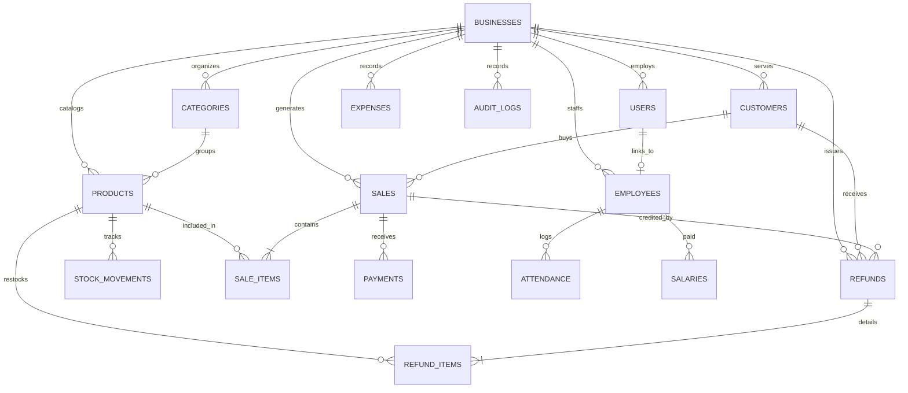

# BUSINESSFLOW — Comprehensive Database Schema Design

This document specifies the relational database schema implemented via MySQL 8.0 and Sequelize ORM. All monetary values use `DECIMAL(12, 2)` to eliminate floating-point inaccuracies. All timestamps are in UTC.

---

## 1. Entity-Relationship Overview

---

## 2. Table Definitions

### 1. `businesses`
Represents an organization, shop, or agency tenant.
| Column | Type | Constraints | Description |
| :--- | :--- | :--- | :--- |
| `id` | INT UNSIGNED | PRIMARY KEY, AUTO_INCREMENT | Unique business ID |
| `name` | VARCHAR(150) | NOT NULL | Registered business or trading name |
| `email` | VARCHAR(120) | NOT NULL | Business contact email |
| `phone` | VARCHAR(25) | NULL | Contact phone number |
| `address` | TEXT | NULL | Physical premises address |
| `tax_number` | VARCHAR(50) | NULL | GSTIN / VAT / Tax ID |
| `state` | VARCHAR(50) | NOT NULL, DEFAULT 'State' | State for intra-state vs inter-state tax logic |
| `currency_code`| VARCHAR(5) | NOT NULL, DEFAULT 'USD' | Currency display code |
| `currency_symbol`| VARCHAR(5)| NOT NULL, DEFAULT '$' | Currency symbol |
| `created_at` | DATETIME | NOT NULL, DEFAULT CURRENT_TIMESTAMP | Created timestamp |
| `updated_at` | DATETIME | NOT NULL, DEFAULT CURRENT_TIMESTAMP ON UPDATE | Updated timestamp |

---

### 2. `users`
Accounts permitted to authenticate and access the system.
| Column | Type | Constraints | Description |
| :--- | :--- | :--- | :--- |
| `id` | INT UNSIGNED | PRIMARY KEY, AUTO_INCREMENT | User ID |
| `business_id` | INT UNSIGNED | NOT NULL, FK -> businesses(id) ON DELETE CASCADE | Associated business |
| `name` | VARCHAR(100) | NOT NULL | Full name |
| `email` | VARCHAR(120) | NOT NULL | Unique per business login email |
| `password_hash`| VARCHAR(255) | NOT NULL | Bcrypt hashed password (cost 12) |
| `role` | ENUM('ADMIN', 'STAFF') | NOT NULL, DEFAULT 'STAFF' | Access role |
| `is_active` | BOOLEAN | NOT NULL, DEFAULT TRUE | User status |
| `last_login_at`| DATETIME | NULL | Timestamp of recent login |
| `created_at` | DATETIME | NOT NULL, DEFAULT CURRENT_TIMESTAMP | Created timestamp |
| `updated_at` | DATETIME | NOT NULL, DEFAULT CURRENT_TIMESTAMP ON UPDATE | Updated timestamp |

*Indexes:*
- `UNIQUE INDEX idx_users_business_email (business_id, email)`
- `INDEX idx_users_role (business_id, role)`

---

### 3. `categories`
Product classification groupings.
| Column | Type | Constraints | Description |
| :--- | :--- | :--- | :--- |
| `id` | INT UNSIGNED | PRIMARY KEY, AUTO_INCREMENT | Category ID |
| `business_id` | INT UNSIGNED | NOT NULL, FK -> businesses(id) ON DELETE CASCADE | Business ID |
| `name` | VARCHAR(80) | NOT NULL | Category name |
| `description` | VARCHAR(255) | NULL | Category summary |
| `created_at` | DATETIME | NOT NULL, DEFAULT CURRENT_TIMESTAMP | Created timestamp |
| `updated_at` | DATETIME | NOT NULL, DEFAULT CURRENT_TIMESTAMP ON UPDATE | Updated timestamp |

*Indexes:*
- `UNIQUE INDEX idx_categories_business_name (business_id, name)`

---

### 4. `products`
Items or services managed in inventory.
| Column | Type | Constraints | Description |
| :--- | :--- | :--- | :--- |
| `id` | INT UNSIGNED | PRIMARY KEY, AUTO_INCREMENT | Product ID |
| `business_id` | INT UNSIGNED | NOT NULL, FK -> businesses(id) ON DELETE CASCADE | Business ID |
| `category_id` | INT UNSIGNED | NULL, FK -> categories(id) ON DELETE SET NULL | Category classification |
| `name` | VARCHAR(150) | NOT NULL | Product name |
| `sku` | VARCHAR(60) | NOT NULL | Stock Keeping Unit |
| `barcode` | VARCHAR(80) | NULL | Barcode / EAN / UPC |
| `description` | TEXT | NULL | Detailed specifications |
| `cost_price` | DECIMAL(12, 2) | NOT NULL, DEFAULT 0.00 | Cost per unit to acquire |
| `selling_price`| DECIMAL(12, 2) | NOT NULL, DEFAULT 0.00 | Base price charged to customer |
| `quantity` | INT | NOT NULL, DEFAULT 0 | Current in-stock quantity |
| `low_stock_threshold` | INT | NOT NULL, DEFAULT 5 | Alert trigger threshold |
| `tax_rate` | DECIMAL(5, 2) | NOT NULL, DEFAULT 0.00 | Applicable Tax % (e.g. 18.00%) |
| `unit` | VARCHAR(20) | NOT NULL, DEFAULT 'pcs' | pcs, kg, box, hrs, etc. |
| `is_active` | BOOLEAN | NOT NULL, DEFAULT TRUE | Soft active flag |
| `created_at` | DATETIME | NOT NULL, DEFAULT CURRENT_TIMESTAMP | Created timestamp |
| `updated_at` | DATETIME | NOT NULL, DEFAULT CURRENT_TIMESTAMP ON UPDATE | Updated timestamp |

*Indexes & Constraints:*
- `UNIQUE INDEX idx_products_business_sku (business_id, sku)`
- `UNIQUE INDEX idx_products_business_barcode (business_id, barcode)`
- `INDEX idx_products_business_category (business_id, category_id)`
- `INDEX idx_products_business_stock (business_id, quantity)`
- `CONSTRAINT chk_products_quantity_non_negative CHECK (quantity >= 0)`

---

### 5. `stock_movements`
Immutable audit log tracking every addition, sale deduction, return, or manual adjustment.
| Column | Type | Constraints | Description |
| :--- | :--- | :--- | :--- |
| `id` | INT UNSIGNED | PRIMARY KEY, AUTO_INCREMENT | Movement ID |
| `business_id` | INT UNSIGNED | NOT NULL, FK -> businesses(id) ON DELETE CASCADE | Business ID |
| `product_id` | INT UNSIGNED | NOT NULL, FK -> products(id) ON DELETE RESTRICT | Product affected |
| `user_id` | INT UNSIGNED | NULL, FK -> users(id) ON DELETE SET NULL | Staff member who triggered movement |
| `type` | ENUM('PURCHASE', 'SALE', 'RETURN', 'DAMAGE', 'ADJUSTMENT') | NOT NULL | Reason for movement |
| `quantity_change` | INT | NOT NULL | Delta (+/- integer) |
| `previous_quantity`| INT | NOT NULL | Snapshot before operation |
| `new_quantity` | INT | NOT NULL | Snapshot after operation |
| `reference_id` | VARCHAR(80) | NULL | e.g. Invoice #, Refund #, or PO # |
| `notes` | VARCHAR(255) | NULL | Context or adjustment notes |
| `created_at` | DATETIME | NOT NULL, DEFAULT CURRENT_TIMESTAMP | Movement timestamp |

*Indexes:*
- `INDEX idx_stock_prod_date (business_id, product_id, created_at)`
- `INDEX idx_stock_business_type (business_id, type)`

---

### 6. `customers`
Clients, patrons, and buyers.
| Column | Type | Constraints | Description |
| :--- | :--- | :--- | :--- |
| `id` | INT UNSIGNED | PRIMARY KEY, AUTO_INCREMENT | Customer ID |
| `business_id` | INT UNSIGNED | NOT NULL, FK -> businesses(id) ON DELETE CASCADE | Business ID |
| `name` | VARCHAR(120) | NOT NULL | Customer or Company Name |
| `email` | VARCHAR(120) | NULL | Email address |
| `phone` | VARCHAR(25) | NULL | Phone number |
| `tax_number` | VARCHAR(50) | NULL | Customer Tax ID / GSTIN |
| `address` | TEXT | NULL | Shipping/Billing address |
| `state` | VARCHAR(50) | NULL | State for inter-state tax rule |
| `credit_limit`| DECIMAL(12, 2) | NOT NULL, DEFAULT 0.00 | Allowed credit balance |
| `outstanding_balance`| DECIMAL(12, 2)| NOT NULL, DEFAULT 0.00 | Current unpaid debt |
| `store_credit` | DECIMAL(12, 2) | NOT NULL, DEFAULT 0.00 | Unallocated refundable store credit balance |
| `created_at` | DATETIME | NOT NULL, DEFAULT CURRENT_TIMESTAMP | Created timestamp |
| `updated_at` | DATETIME | NOT NULL, DEFAULT CURRENT_TIMESTAMP ON UPDATE | Updated timestamp |

*Indexes:*
- `INDEX idx_customers_business_phone (business_id, phone)`
- `INDEX idx_customers_business_name (business_id, name)`

---

### 7. `sales` (Invoices)
Header record for billing and sales transactions.
| Column | Type | Constraints | Description |
| :--- | :--- | :--- | :--- |
| `id` | INT UNSIGNED | PRIMARY KEY, AUTO_INCREMENT | Sale ID |
| `business_id` | INT UNSIGNED | NOT NULL, FK -> businesses(id) ON DELETE CASCADE | Business ID |
| `customer_id` | INT UNSIGNED | NULL, FK -> customers(id) ON DELETE SET NULL | Customer ID (or null for walk-in) |
| `user_id` | INT UNSIGNED | NOT NULL, FK -> users(id) ON DELETE RESTRICT | Cashier / Sales rep |
| `invoice_number`| VARCHAR(60) | NOT NULL | Formatted unique invoice # (e.g. INV-2026-0001) |
| `invoice_date`| DATE | NOT NULL | Date of issuance |
| `subtotal` | DECIMAL(12, 2) | NOT NULL, DEFAULT 0.00 | Sum of taxable line amounts |
| `discount_total`| DECIMAL(12, 2)| NOT NULL, DEFAULT 0.00 | Sum of all line item discounts |
| `order_discount`| DECIMAL(12, 2)| NOT NULL, DEFAULT 0.00 | Additional overall invoice discount |
| `tax_total` | DECIMAL(12, 2) | NOT NULL, DEFAULT 0.00 | Sum of all taxes (CGST+SGST+IGST) |
| `cgst_total` | DECIMAL(12, 2) | NOT NULL, DEFAULT 0.00 | Central tax portion |
| `sgst_total` | DECIMAL(12, 2) | NOT NULL, DEFAULT 0.00 | State tax portion |
| `igst_total` | DECIMAL(12, 2) | NOT NULL, DEFAULT 0.00 | Integrated inter-state tax portion |
| `round_off` | DECIMAL(6, 2) | NOT NULL, DEFAULT 0.00 | Commercial round-off adjustment |
| `grand_total` | DECIMAL(12, 2) | NOT NULL, DEFAULT 0.00 | Final payable = Subtotal - OrderDiscount + Tax + RoundOff |
| `paid_amount` | DECIMAL(12, 2) | NOT NULL, DEFAULT 0.00 | Sum of payments received |
| `refunded_amount`| DECIMAL(12, 2)| NOT NULL, DEFAULT 0.00 | Total value of refunds processed against invoice |
| `balance_due` | DECIMAL(12, 2) | NOT NULL, DEFAULT 0.00 | Remaining unpaid balance |
| `payment_status`| ENUM('UNPAID', 'PARTIALLY_PAID', 'PAID') | NOT NULL, DEFAULT 'UNPAID' | Payment status |
| `status` | ENUM('COMPLETED', 'PARTIALLY_REFUNDED', 'REFUNDED', 'CANCELLED') | NOT NULL, DEFAULT 'COMPLETED' | Order lifecycle state |
| `notes` | TEXT | NULL | Invoice remarks / customer notes |
| `created_at` | DATETIME | NOT NULL, DEFAULT CURRENT_TIMESTAMP | Created timestamp |
| `updated_at` | DATETIME | NOT NULL, DEFAULT CURRENT_TIMESTAMP ON UPDATE | Updated timestamp |

*Indexes:*
- `UNIQUE INDEX idx_sales_business_invoice_number (business_id, invoice_number)`
- `INDEX idx_sales_business_date (business_id, invoice_date)`
- `INDEX idx_sales_business_customer (business_id, customer_id)`
- `INDEX idx_sales_business_status (business_id, status)`

---

### 8. `sale_items`
Individual line items inside an invoice.
| Column | Type | Constraints | Description |
| :--- | :--- | :--- | :--- |
| `id` | INT UNSIGNED | PRIMARY KEY, AUTO_INCREMENT | Sale Item ID |
| `business_id` | INT UNSIGNED | NOT NULL, FK -> businesses(id) ON DELETE CASCADE | Business ID |
| `sale_id` | INT UNSIGNED | NOT NULL, FK -> sales(id) ON DELETE CASCADE | Parent sale header |
| `product_id` | INT UNSIGNED | NOT NULL, FK -> products(id) ON DELETE RESTRICT | Catalog product |
| `product_name`| VARCHAR(150) | NOT NULL | Snapshot of product title at time of sale |
| `product_sku` | VARCHAR(60) | NOT NULL | Snapshot of SKU |
| `unit_cost_price` | DECIMAL(12, 2) | NOT NULL | Unit cost snapshot (used for exact COGS) |
| `unit_selling_price`| DECIMAL(12, 2)| NOT NULL | Unit price before discount |
| `quantity` | INT | NOT NULL | Quantity sold |
| `refunded_quantity`| INT | NOT NULL, DEFAULT 0 | Quantity returned across refunds |
| `discount_percentage`| DECIMAL(5, 2)| NOT NULL, DEFAULT 0.00 | Line discount % |
| `discount_amount`| DECIMAL(12, 2)| NOT NULL, DEFAULT 0.00 | Absolute line discount |
| `taxable_amount`| DECIMAL(12, 2)| NOT NULL, DEFAULT 0.00 | Amount subject to tax |
| `tax_rate` | DECIMAL(5, 2) | NOT NULL, DEFAULT 0.00 | Applied Tax Rate % |
| `cgst_amount` | DECIMAL(12, 2) | NOT NULL, DEFAULT 0.00 | CGST amount |
| `sgst_amount` | DECIMAL(12, 2) | NOT NULL, DEFAULT 0.00 | SGST amount |
| `igst_amount` | DECIMAL(12, 2) | NOT NULL, DEFAULT 0.00 | IGST amount |
| `tax_amount` | DECIMAL(12, 2) | NOT NULL, DEFAULT 0.00 | Total line tax |
| `line_total` | DECIMAL(12, 2) | NOT NULL, DEFAULT 0.00 | Final line total |

*Indexes & Constraints:*
- `INDEX idx_sale_items_sale_id (sale_id)`
- `INDEX idx_sale_items_product_id (product_id)`
- `INDEX idx_sale_items_business (business_id)`
- `CONSTRAINT chk_refunded_quantity CHECK (refunded_quantity <= quantity)`

---

### 9. `payments`
Tendered payments against sales. Original payment records are strictly immutable.
| Column | Type | Constraints | Description |
| :--- | :--- | :--- | :--- |
| `id` | INT UNSIGNED | PRIMARY KEY, AUTO_INCREMENT | Payment ID |
| `business_id` | INT UNSIGNED | NOT NULL, FK -> businesses(id) ON DELETE CASCADE | Business ID |
| `sale_id` | INT UNSIGNED | NOT NULL, FK -> sales(id) ON DELETE CASCADE | Associated invoice |
| `amount` | DECIMAL(12, 2) | NOT NULL | Amount collected |
| `payment_method`| ENUM('CASH', 'CARD', 'UPI', 'BANK_TRANSFER', 'CHEQUE', 'OTHER') | NOT NULL | Tender type |
| `reference_number`| VARCHAR(100)| NULL | Transaction ID / Cheque # |
| `payment_date`| DATETIME | NOT NULL, DEFAULT CURRENT_TIMESTAMP | Payment logged timestamp |
| `notes` | VARCHAR(255) | NULL | Payment remarks |

*Indexes:*
- `INDEX idx_payments_business_sale (business_id, sale_id)`
- `INDEX idx_payments_date (business_id, payment_date)`

---

### 10. `refunds`
Master record tracking invoice refunds and cancellations.
| Column | Type | Constraints | Description |
| :--- | :--- | :--- | :--- |
| `id` | INT UNSIGNED | PRIMARY KEY, AUTO_INCREMENT | Refund ID |
| `business_id` | INT UNSIGNED | NOT NULL, FK -> businesses(id) ON DELETE CASCADE | Business ID |
| `sale_id` | INT UNSIGNED | NOT NULL, FK -> sales(id) ON DELETE RESTRICT | Invoiced sale refunded |
| `customer_id` | INT UNSIGNED | NULL, FK -> customers(id) ON DELETE SET NULL | Customer credited |
| `user_id` | INT UNSIGNED | NOT NULL, FK -> users(id) ON DELETE RESTRICT | Staff who processed refund |
| `refund_number`| VARCHAR(60) | NOT NULL | Formatted unique refund # (e.g. REF-2026-0001) |
| `refund_date` | DATE | NOT NULL | Date of refund |
| `subtotal_refunded`| DECIMAL(12, 2)| NOT NULL, DEFAULT 0.00 | Net taxable sales refunded |
| `tax_refunded` | DECIMAL(12, 2)| NOT NULL, DEFAULT 0.00 | Reversed tax portion |
| `total_refunded`| DECIMAL(12, 2)| NOT NULL, DEFAULT 0.00 | Gross refund amount disbursed/credited |
| `refund_method`| ENUM('CASH', 'CARD', 'UPI', 'BANK_TRANSFER', 'STORE_CREDIT', 'ADJUSTMENT') | NOT NULL | Refund disbursement channel |
| `reason` | VARCHAR(255) | NOT NULL | Reason for return/cancellation |
| `notes` | TEXT | NULL | Administrative remarks |
| `created_at` | DATETIME | NOT NULL, DEFAULT CURRENT_TIMESTAMP | Created timestamp |
| `updated_at` | DATETIME | NOT NULL, DEFAULT CURRENT_TIMESTAMP ON UPDATE | Updated timestamp |

*Indexes:*
- `UNIQUE INDEX idx_refunds_business_number (business_id, refund_number)`
- `INDEX idx_refunds_business_sale (business_id, sale_id)`
- `INDEX idx_refunds_date (business_id, refund_date)`

---

### 11. `refund_items`
Specific line items returned and restock flags.
| Column | Type | Constraints | Description |
| :--- | :--- | :--- | :--- |
| `id` | INT UNSIGNED | PRIMARY KEY, AUTO_INCREMENT | Refund Item ID |
| `business_id` | INT UNSIGNED | NOT NULL, FK -> businesses(id) ON DELETE CASCADE | Business ID |
| `refund_id` | INT UNSIGNED | NOT NULL, FK -> refunds(id) ON DELETE CASCADE | Parent refund record |
| `sale_item_id` | INT UNSIGNED | NOT NULL, FK -> sale_items(id) ON DELETE RESTRICT | Original sale item |
| `product_id` | INT UNSIGNED | NOT NULL, FK -> products(id) ON DELETE RESTRICT | Catalog product |
| `quantity` | INT | NOT NULL | Quantity returned |
| `unit_selling_price`| DECIMAL(12, 2)| NOT NULL | Snapshot of original selling price |
| `tax_rate` | DECIMAL(5, 2) | NOT NULL | Tax rate reversed |
| `tax_amount` | DECIMAL(12, 2) | NOT NULL | Tax reversed on returned quantity |
| `total_amount` | DECIMAL(12, 2) | NOT NULL | Gross line refund = (Qty * Price) + Tax |
| `restock` | BOOLEAN | NOT NULL, DEFAULT TRUE | TRUE: added back to stock; FALSE: damaged/written off |
| `created_at` | DATETIME | NOT NULL, DEFAULT CURRENT_TIMESTAMP | Created timestamp |

*Indexes:*
- `INDEX idx_refund_items_refund_id (refund_id)`
- `INDEX idx_refund_items_product_id (product_id)`

---

### 12. `expenses`
Operational expenses incurred by the business.
| Column | Type | Constraints | Description |
| :--- | :--- | :--- | :--- |
| `id` | INT UNSIGNED | PRIMARY KEY, AUTO_INCREMENT | Expense ID |
| `business_id` | INT UNSIGNED | NOT NULL, FK -> businesses(id) ON DELETE CASCADE | Business ID |
| `category` | VARCHAR(80) | NOT NULL | Rent, Utilities, Marketing, Supplies, etc. |
| `amount` | DECIMAL(12, 2) | NOT NULL | Expense amount |
| `expense_date`| DATE | NOT NULL | Date expense occurred |
| `payment_method`| ENUM('CASH', 'CARD', 'UPI', 'BANK_TRANSFER', 'OTHER') | NOT NULL, DEFAULT 'BANK_TRANSFER' | Payment channel |
| `description` | VARCHAR(255) | NOT NULL | Brief explanation |
| `receipt_url` | VARCHAR(255) | NULL | Document attachment URL |
| `created_by` | INT UNSIGNED | NULL, FK -> users(id) ON DELETE SET NULL | User who logged expense |
| `created_at` | DATETIME | NOT NULL, DEFAULT CURRENT_TIMESTAMP | Created timestamp |
| `updated_at` | DATETIME | NOT NULL, DEFAULT CURRENT_TIMESTAMP ON UPDATE | Updated timestamp |

*Indexes:*
- `INDEX idx_expenses_date (business_id, expense_date)`
- `INDEX idx_expenses_cat (business_id, category)`

---

### 13. `employees`
Staff details, payroll rates, and organizational role.
| Column | Type | Constraints | Description |
| :--- | :--- | :--- | :--- |
| `id` | INT UNSIGNED | PRIMARY KEY, AUTO_INCREMENT | Employee ID |
| `business_id` | INT UNSIGNED | NOT NULL, FK -> businesses(id) ON DELETE CASCADE | Business ID |
| `user_id` | INT UNSIGNED | NULL, UNIQUE, FK -> users(id) ON DELETE SET NULL | Optional linked login account |
| `first_name` | VARCHAR(60) | NOT NULL | First name |
| `last_name` | VARCHAR(60) | NOT NULL | Last name |
| `email` | VARCHAR(120) | NULL | Personal or work email |
| `phone` | VARCHAR(25) | NULL | Contact number |
| `designation` | VARCHAR(80) | NOT NULL | Title / Role (e.g. Store Manager, Cashier) |
| `department` | VARCHAR(80) | NULL | Operations, Sales, Logistics |
| `base_salary` | DECIMAL(12, 2) | NOT NULL, DEFAULT 0.00 | Monthly base salary compensation |
| `joining_date`| DATE | NOT NULL | Employment start date |
| `status` | ENUM('ACTIVE', 'ON_LEAVE', 'TERMINATED') | NOT NULL, DEFAULT 'ACTIVE' | Employment status |
| `created_at` | DATETIME | NOT NULL, DEFAULT CURRENT_TIMESTAMP | Created timestamp |
| `updated_at` | DATETIME | NOT NULL, DEFAULT CURRENT_TIMESTAMP ON UPDATE | Updated timestamp |

*Indexes:*
- `INDEX idx_employees_business_status (business_id, status)`

---

### 14. `attendance`
Daily employee attendance records.
| Column | Type | Constraints | Description |
| :--- | :--- | :--- | :--- |
| `id` | INT UNSIGNED | PRIMARY KEY, AUTO_INCREMENT | Attendance ID |
| `business_id` | INT UNSIGNED | NOT NULL, FK -> businesses(id) ON DELETE CASCADE | Business ID |
| `employee_id` | INT UNSIGNED | NOT NULL, FK -> employees(id) ON DELETE CASCADE | Employee |
| `date` | DATE | NOT NULL | Attendance date |
| `status` | ENUM('PRESENT', 'ABSENT', 'HALF_DAY', 'LEAVE', 'HOLIDAY') | NOT NULL, DEFAULT 'PRESENT' | Attendance classification |
| `check_in_time`| TIME | NULL | In-time |
| `check_out_time`| TIME | NULL | Out-time |
| `notes` | VARCHAR(255) | NULL | Remarks |
| `created_at` | DATETIME | NOT NULL, DEFAULT CURRENT_TIMESTAMP | Created timestamp |
| `updated_at` | DATETIME | NOT NULL, DEFAULT CURRENT_TIMESTAMP ON UPDATE | Updated timestamp |

*Indexes & Constraints:*
- `UNIQUE INDEX idx_employee_daily_attendance (business_id, employee_id, date)`

---

### 15. `salaries`
Salary disbursements and payment audit tracking.
| Column | Type | Constraints | Description |
| :--- | :--- | :--- | :--- |
| `id` | INT UNSIGNED | PRIMARY KEY, AUTO_INCREMENT | Salary Record ID |
| `business_id` | INT UNSIGNED | NOT NULL, FK -> businesses(id) ON DELETE CASCADE | Business ID |
| `employee_id` | INT UNSIGNED | NOT NULL, FK -> employees(id) ON DELETE CASCADE | Employee |
| `month` | TINYINT UNSIGNED| NOT NULL | Month (1 - 12) |
| `year` | SMALLINT UNSIGNED| NOT NULL | Year (e.g. 2026) |
| `base_amount` | DECIMAL(12, 2) | NOT NULL | Standard base salary |
| `bonus_amount`| DECIMAL(12, 2) | NOT NULL, DEFAULT 0.00 | Performance/incentive bonus |
| `deductions` | DECIMAL(12, 2) | NOT NULL, DEFAULT 0.00 | Unpaid leaves or tax withholdings |
| `net_amount` | DECIMAL(12, 2) | NOT NULL | `base_amount + bonus_amount - deductions` |
| `payment_status`| ENUM('PENDING', 'PAID', 'CANCELLED') | NOT NULL, DEFAULT 'PENDING' | Disbursement status |
| `payment_date`| DATE | NULL | Date transferred |
| `payment_method`| ENUM('BANK_TRANSFER', 'CASH', 'CHEQUE', 'OTHER') | NOT NULL, DEFAULT 'BANK_TRANSFER' | Payment method |
| `notes` | VARCHAR(255) | NULL | Payment reference or note |
| `created_at` | DATETIME | NOT NULL, DEFAULT CURRENT_TIMESTAMP | Created timestamp |
| `updated_at` | DATETIME | NOT NULL, DEFAULT CURRENT_TIMESTAMP ON UPDATE | Updated timestamp |

*Indexes & Constraints:*
- `UNIQUE INDEX idx_employee_month_salary (business_id, employee_id, month, year)`

---

### 16. `audit_logs`
System-wide immutable security and administrative audit trail.
| Column | Type | Constraints | Description |
| :--- | :--- | :--- | :--- |
| `id` | INT UNSIGNED | PRIMARY KEY, AUTO_INCREMENT | Audit ID |
| `business_id` | INT UNSIGNED | NOT NULL, FK -> businesses(id) ON DELETE CASCADE | Business ID |
| `user_id` | INT UNSIGNED | NULL, FK -> users(id) ON DELETE SET NULL | Acting user |
| `action` | VARCHAR(60) | NOT NULL | CREATE_PRODUCT, REFUND_SALE, ADJUST_STOCK, etc. |
| `entity` | VARCHAR(50) | NOT NULL | Table or Domain Entity affected |
| `entity_id` | VARCHAR(50) | NULL | Primary key of affected record |
| `changes` | JSON | NULL | JSON diff `{ "before": {...}, "after": {...} }` |
| `ip_address` | VARCHAR(45) | NULL | Client IP address |
| `created_at` | DATETIME | NOT NULL, DEFAULT CURRENT_TIMESTAMP | Action timestamp |

*Indexes:*
- `INDEX idx_audit_business_action (business_id, action, created_at)`
